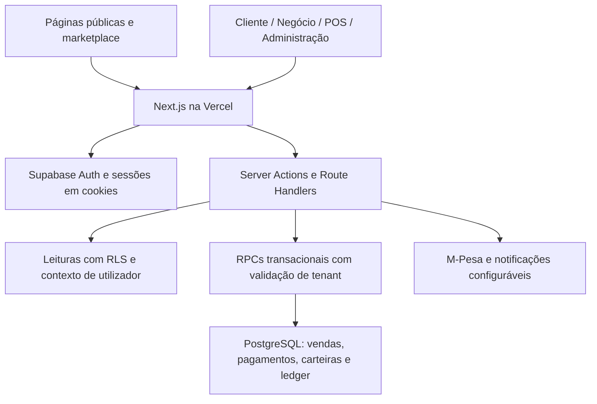

# Auditoria de estado VUYELA — 3 de novembro de 2026

## Conclusão

A plataforma tem uma base funcional substancial e produção acessível. A arquitetura
atual é adequada ao produto: um monólito modular Next.js, com portais separados,
operações no servidor e PostgreSQL como fronteira transacional. O próximo ciclo deve
concentrar-se em segurança, recuperação de dados, ambientes e validação operacional.
Não há evidência suficiente para declarar todos os fluxos prontos para uso comercial.

Esta auditoria foi de leitura dos serviços e revisão de código/documentação. Não
alterou configurações externas, permissões, base de dados ou deploys. O SMTP e a
recuperação entre dispositivos continuam adiados por decisão do utilizador.

## Estado confirmado

| Área                 | Evidência                                                             | Limite da conclusão                                                    |
| -------------------- | --------------------------------------------------------------------- | ---------------------------------------------------------------------- |
| GitHub               | `main` em `3e9b3ed0952f5ec27df76c4b94b60725f5fe8f93`                  | O código local tem alterações ainda não publicadas                     |
| Vercel               | Projeto `vuyela-moz/vuyela`, produção Ready no mesmo commit           | Ready não valida os fluxos privados                                    |
| Aplicação            | `/api/health` devolveu HTTP 200, `state=ready`, 182 ms nessa amostra  | Verifica configuração e leitura de `plans`, não toda a base            |
| CI                   | Quality gate #34 aprovado; job `live-e2e` ignorado                    | Não comprova login, isolamento e operações reais dos quatro portais    |
| Supabase Health      | 0 erros, 0 avisos, 0 sugestões no painel                              | Não equivale a uma auditoria de segurança completa                     |
| Supabase Security    | 0 erros, 68 avisos e 1 sugestão                                       | Necessária classificação de privilégios por função                     |
| Supabase Performance | 0 erros, 0 avisos e 109 sugestões                                     | Inclui chaves estrangeiras sem índice e índices sem uso                |
| Migrações            | 47 entradas remotas e 47 ficheiros SQL locais                         | Conferência de inventário; não houve comparação de todos os corpos SQL |
| Backups              | O painel informa que o plano Free não inclui backups do projeto       | Não foi demonstrado backup externo nem restauração testada             |
| Auth                 | Recuperação no mesmo navegador/dispositivo confirmada pelo utilizador | SMTP próprio e recuperação entre dispositivos não ativos               |

Fontes externas:

- [Vercel — projeto](https://vercel.com/vuyela-moz/vuyela)
- [GitHub — commit publicado](https://github.com/Nunes99/VUYELA/commit/3e9b3ed0952f5ec27df76c4b94b60725f5fe8f93)
- [GitHub — quality gate #34](https://github.com/Nunes99/VUYELA/actions/runs/39337059641)
- [GitHub — monitor de saúde](https://github.com/Nunes99/VUYELA/actions/workflows/health-monitor.yml)
- [Supabase — segurança](https://supabase.com/dashboard/project/ytumxecywfxpwlisgvee/advisors/security)
- [Supabase — desempenho](https://supabase.com/dashboard/project/ytumxecywfxpwlisgvee/advisors/performance)
- [Supabase — migrações](https://supabase.com/dashboard/project/ytumxecywfxpwlisgvee/database/migrations)
- [Supabase — backups](https://supabase.com/dashboard/project/ytumxecywfxpwlisgvee/database/backups/scheduled)

## Arquitetura observada

- `app/` organiza rotas, metadados e composição de páginas.
- `features/` organiza autenticação, cliente, negócio, POS, pagamentos, campanhas,
  notificações, administração, pesquisa e PWA por domínio funcional.
- `lib/auth/` centraliza identidade, RBAC, permissões administrativas e MFA.
- `lib/supabase/` separa clientes públicos, autenticados e privilegiados; o cliente
  administrativo está marcado `server-only`.
- As RPCs de fidelização revistas usam transações PostgreSQL, bloqueios `FOR UPDATE`
  e lançamentos no ledger. A validação real de concorrência e isolamento permanece
  necessária; testes estáticos não substituem execução contra a base.
- Há design system partilhado, TypeScript estrito, páginas públicas renderizadas no
  servidor e regras de indexação para evitar páginas programáticas sem conteúdo útil.
- Vercel usa `dub1`; o Supabase está em `eu-west-1`, evitando regiões distantes.
- Os quatro portais possuem configuração PWA. Operações de saldo permanecem online.

## Constatações e prioridades

### Prioridade alta — proteção e operação

1. **Backups e restauração:** definir retenção, destino e responsáveis. Verificar
   exportação/restauração de PostgreSQL e cobertura separada de ficheiros de Storage.
   O critério de conclusão é restaurar um ambiente isolado, não apenas gerar um dump.

2. **Privilégios Supabase:** classificar os 68 avisos, começando pelas funções
   `SECURITY DEFINER`. O painel mostra uma função pública de validação de convites e
   diversas RPCs para utilizadores autenticados. Algumas exposições são intencionais.
   Rever `GRANT`, `REVOKE`, `search_path`, identidade, tenant, filial e validação dos
   parâmetros antes de qualquer alteração; não revogar tudo indiscriminadamente.

3. **Ambientes separados:** `NEXT_PUBLIC_SUPABASE_URL` está configurada para
   Production e Preview com o mesmo projeto. Criar um ambiente isolado de testes
   antes de testes transacionais ou de equipas em previews. Não copiar dados pessoais
   de produção sem necessidade.

4. **E2E autenticado:** o último CI aprovou `quality`, mas ignorou `live-e2e`.
   As quatro contas dedicadas não estão configuradas em `.env.local`; os secrets do
   GitHub não foram inspecionados. Preparar cliente, proprietário, caixa e administrador
   de teste num ambiente isolado. O teste atual do admin aceita chegar a `/admin/mfa`;
   isso não valida o acesso após completar MFA.

### Prioridade seguinte — entrega reproduzível

5. **Publicar alterações locais com revisão:** antes deste relatório existiam 11
   ficheiros modificados e 2 novos, incluindo suporte à chave publicável, middleware,
   testes e documentação. Criar uma branch, rever o diff, executar o gate apropriado,
   abrir PR e publicar a versão aprovada. Não misturar alterações de produto novas.

6. **Migrações reproduzíveis:** 46 dos 47 ficheiros locais não têm prefixo temporal;
   o projeto depende de uma ordem manual. O histórico remoto tem versões temporais.
   Reconciliar os nomes e a ordem sem voltar a executar SQL já aplicado. O guia de
   migrações omite:

   - `20260831193705_add_business_catalog_categories.sql`;
   - `integrate_mpesa_pos_payments.sql`;
   - `persist_business_signup_branch_details.sql`;
   - `secure_mpesa_provider_data.sql`.

   Critério: construir uma base vazia de staging com o mesmo esquema esperado e
   demonstrar que novas migrações podem ser aplicadas sem dependência de memória.

7. **CI e monitorização:** atualizar as Actions que receberam aviso de runtime
   Node.js 20 obsoleto e rever a migração de `ubuntu-latest`. Confirmar proteção de
   `main` e checks obrigatórios; não foi possível verificar estas configurações com
   a sessão GitHub pública. O monitor tem cron a cada cinco minutos, mas o histórico
   visível mostra intervalos maiores; não assumir cobertura contínua de cinco minutos
   sem confirmar a frequência efetiva.

### Antes de um piloto operacional

8. **Validar a cadeia completa:** negócio e filial → operador e terminal → cliente
   e cartão → venda manual → pontos ganhos → utilização de pontos → estorno →
   reconciliação entre venda, pagamento, carteira, ledger e relatórios. Incluir duplo
   envio, duas caixas concorrentes e tentativa entre negócios diferentes.

9. **Integrações:** há adaptador M-Pesa e tratamento de callback no código, mas não
   foi feita uma transação do provedor nesta auditoria. Validar sandbox, credenciais,
   callback, idempotência e reconciliação antes de apresentar o canal como ativo.
   E-Mola, mKesh, SMS, WhatsApp e push não devem ser tratados como integrações prontas.
   E-mail de campanhas via Resend é separado de SMTP do Supabase Auth.

10. **Produto e experiência:** validar mobile, acessibilidade, impressão/recibo e
    comportamento com rede instável; rever contratação de planos e faturação,
    relatórios e gestão de conteúdo. A auditoria funcional antiga contém lacunas que
    fases posteriores já resolveram; atualizar a matriz com evidência por fluxo.

11. **Desempenho e descoberta:** priorizar as chaves estrangeiras sem índice em
    `business_catalog_categories`, `business_catalog_items` e `transaction_items`,
    após verificar planos de execução. Não eliminar índices apenas por não terem uso
    num projeto com pouco tráfego. Medir Core Web Vitals, rever SEO com dados reais e
    decidir domínio próprio quando se preparar aquisição de clientes.

## Sequência de execução proposta

| Etapa | Entrega                                     | Critério de saída                                                   |
| ----- | ------------------------------------------- | ------------------------------------------------------------------- |
| 1     | Baseline revisto e PR das alterações locais | CI aprovado e commit/deploy identificáveis                          |
| 2     | Backups e staging reproduzível              | Restauração isolada e migrações completas verificadas               |
| 3     | Revisão de RLS/RPCs e contas E2E            | Exposições classificadas; acessos cruzados bloqueados em testes     |
| 4     | Fluxo operacional completo                  | Venda, resgate, estorno e concorrência reconciliados                |
| 5     | Piloto limitado                             | Um negócio, filial e operador com suporte e monitorização definidos |
| 6     | Expansão                                    | Integrações e canais ativados apenas após validação e configuração  |

## Validação disponível e limites

Nesta conversa, antes da auditoria, passaram lint, typecheck, build, 330 testes
unitários/integração existentes, 7 novos testes de middleware e 21 testes de navegador
de autenticação (1 caso ignorado por se aplicar apenas ao outro dispositivo). Os 30
testes focados de recuperação/middleware também foram aprovados posteriormente.
Estes resultados não representam uma nova execução da suíte E2E completa durante
esta auditoria e não comprovam operações autenticadas de produção.

Não foram feitos testes de carga, restauro, penetração, alteração de saldo, pagamentos
reais ou revisão exaustiva de todas as políticas e funções. A igualdade de inventário
das migrações não prova ausência de drift no SQL. O acesso público ao GitHub permitiu
ver commits e CI; leitura adicional da API atingiu o limite de pedidos. Não foram
verificados secrets, regras de branch, logs privados ou configurações completas de
pagamentos e entregabilidade.

## Decisão recomendada

Manter a arquitetura atual. Concluir a estabilização operacional antes de acrescentar
novos canais ou uma camada de serviços. Preservar a decisão de usar recuperação no
mesmo navegador/dispositivo por agora; SMTP, domínio próprio e recuperação entre
dispositivos ficam fora do próximo ciclo imediato, salvo nova prioridade do produto.
